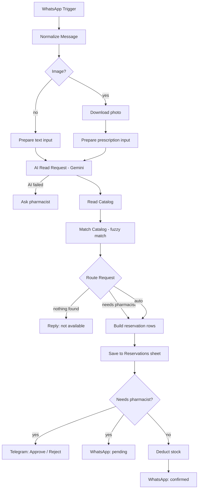
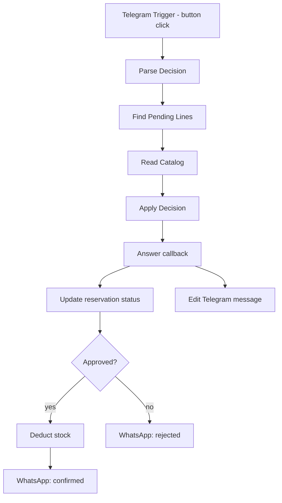

# 💊 Dawaa — Pharmacy Reservation Assistant (n8n)

A WhatsApp-based medicine request and reservation system for pharmacies, built with **n8n**, **Google Gemini**, **Google Sheets** and **Telegram**. A customer sends a medicine name (or a prescription photo); the system reads it with AI, matches it against the pharmacy catalog, reserves the stock, and keeps a pharmacist in the loop whenever a human decision is needed.

> **ملخص بالعربي:** العميل يبعت اسم دواء أو صورة روشتة على واتساب، الـ AI يقرأ الطلب، النظام يطابقه مع كتالوج الصيدلية ويحجز الدواء ويخصم المخزون. أي حالة محتاجة قرار بشري (روشتة، دواء مراقب، مخزون ناقص، اسم غير واضح) بتروح للصيدلي على تيليجرام بزرار موافقة/رفض. الحجوزات المنتهية بترجّع المخزون تلقائياً، وفيه تنبيه يومي بالنواقص وتنبيهات للأخطاء.

---

## ✨ Features

- **Natural requests on WhatsApp:** plain text, a photo of a prescription, or a **voice note** (Egyptian Arabic, transcribed by Gemini).
- **AI extraction** of drug name, strength and quantity with Gemini.
- **Fuzzy catalog matching** (typo tolerant, e.g. `Soncor` → `Concor`).
- **Automatic reservation** for clean requests, with stock deduction and an expiry time.
- **Pharmacist-in-the-loop** on Telegram with Approve / Reject inline buttons.
- **Safe stock handling:** insufficient stock blocks approval; repeated clicks are ignored.
- **Auto-expiry:** expired reservations are released and the stock is returned.
- **Daily low-stock report** sent to the pharmacist.
- **Centralized error handling:** classified, logged, and alerted (critical errors also by email).

## 🏗️ Architecture

### Workflow 1 — Requests & Reservations

### Workflow 2 — Pharmacist decision

### Workflow 3 — Errors & scheduled jobs

| Flow | Trigger | What it does |
|---|---|---|
| **Error handling** | Error Trigger | Classify error → log to `Errors` sheet → Telegram alert → email if `critical` |
| **Reservation expiry** | Every 15 minutes | Mark expired reservations → notify the customer → return stock to the catalog |
| **Low-stock report** | Daily at 22:00 | List items with stock below 10 → send to the pharmacist on Telegram |

## 📁 Repository contents

| File | Description |
|---|---|
| `Dawaa.json` | Workflow 1 (requests & reservations) and Workflow 2 (pharmacist decision) |
| `Erorr_Dawaa.json` | Error handling, reservation expiry, and low-stock report |
| `index.html` | Dashboard and interactive simulator. Optional **live mode** sends your messages to n8n |

> Both files are sanitized: IDs and contact details are replaced with `YOUR_...` placeholders. No tokens or API keys are included.

## 🧠 Business rules

A request is **auto-reserved** only when: it is plain text, every drug matched exactly, stock is sufficient, and no drug is controlled.

It is **sent to the pharmacist** when any of these is true:

- the request is a prescription photo,
- the message is unreadable,
- a drug name is unclear or not in the catalog,
- the match was approximate (fuzzy),
- a drug is marked `controlled`,
- stock is insufficient (an alternative with the same active ingredient is suggested).

**Stock policy**

| Event | Stock |
|---|---|
| Auto reservation | Deducted immediately |
| Pharmacist approves | Deducted after checking stock is enough (otherwise approval is blocked) |
| Pharmacist rejects | Unchanged |
| Reservation expires | Returned to the catalog |

**Reservation statuses:** `reserved`, `pending_pharmacist`, `rejected`, `not_available`, `expired`.

## 🗄️ Data model (Google Sheets)

Create one spreadsheet with three tabs:

**`Catalog`**

| sku | name | active_ingredient | strength | form | price_egp | stock | reorder_level | controlled |
|---|---|---|---|---|---|---|---|---|
| P001 | Panadol | paracetamol | 500 mg | tablets x24 | 45 | 30 | 10 | no |

**`Reservations`**

`res_id, created_at, customer_id, wa_phone_id, customer_name, sku, name, qty, total_egp, status, expires_at, pharmacist, note`

**`Errors`**

`time, workflow, node, type, execution_url, message`

## 🧰 Tech stack

- **n8n** (self-hosted) — orchestration
- **WhatsApp Business Cloud API** — customer channel
- **Telegram Bot API** — pharmacist channel (inline keyboard)
- **Google Gemini** (`gemini-2.5-flash`) — reading text and prescription images
- **Google Sheets** — catalog, reservations and error log
- **Gmail** — critical error emails

## 🚀 Setup

1. **Create the spreadsheet** with the three tabs above and add some catalog rows.
2. **Create the credentials in n8n:** WhatsApp Business Cloud, Telegram Bot, Google Sheets (OAuth2), Google Gemini (PaLM) API, and Gmail (OAuth2).
3. **Import** `Dawaa.json` and `Erorr_Dawaa.json`.
4. **Replace the placeholders:**
   - `YOUR_GOOGLE_SHEET_ID` — your spreadsheet
   - `YOUR_TELEGRAM_CHAT_ID` — the pharmacist's (or group's) chat ID
   - `YOUR_WHATSAPP_PHONE_NUMBER_ID` — the sender number ID from Meta
   - `your-email@example.com` — the email for critical alerts
5. **Re-select the credential** on each node that shows a missing-credential warning.
6. **Settings:** set the timezone (the code assumes `Africa/Cairo`), and set `errordawaa` as the **Error workflow** of the main workflow.
7. **Webhooks:** WhatsApp and Telegram need a public **HTTPS** URL. For local runs use Cloudflare Tunnel or ngrok and set `WEBHOOK_URL`.
8. **Publish** the workflows. Triggers and schedules only run on published workflows.

## 🎙️ Voice notes

A voice note takes the same path as text: it is downloaded, sent to Gemini, matched against the catalog, and routed. Gemini also returns a `confidence` flag.

- **Auto-reserved** only when confidence is `high`, the match is exact, stock is enough, and the drug is not controlled.
- **Sent to the pharmacist** when confidence is `low` or missing, or for any of the usual reasons (approximate match, controlled drug, low stock).
- The transcript is stored in the reservation note; the audio itself is not stored.

## 🌐 Live mode for the website demo

The dashboard works offline with sample data. To make it drive the real workflow:

1. In `Dawaa.json`, open **Website to WhatsApp Shape** and set `DEMO_PHONE` to your own WhatsApp number (international format, no `+`).
2. **Publish** the workflow. The page posts to `https://YOUR-HOST/webhook/dawaa-demo` (use `/webhook-test/...` while testing in the editor).
3. Open `index.html` over `http://localhost` or HTTPS (not as a sandboxed preview), click **⚙️ ربط n8n Docker**, and paste your base URL and webhook URL.
4. Send a message or hold the mic button: the request appears in n8n **Executions** and the replies arrive on WhatsApp.

The webhook only ever messages `DEMO_PHONE`. Keep its URL private and unpublish it after the demo. Voice in the browser uses the Web Speech API (Chrome or Edge).

## 🧪 Test scenarios

| Send this | Expected result |
|---|---|
| `Panadol` | Auto-reserved, stock deducted, customer notified with expiry |
| A misspelled name | Fuzzy match → goes to the pharmacist |
| A controlled drug | Goes to the pharmacist |
| An out-of-stock drug | Goes to the pharmacist, with an alternative if available |
| A prescription photo | Goes to the pharmacist |
| Approve / Reject buttons | Reservation updated, message edited, customer notified |
| Click a button twice | Second click is ignored ("already decided") |
| Wait past `expires_at` | Reservation marked `expired`, stock returned |
| Stock below 10 at 22:00 | Low-stock list arrives on Telegram |

## ⚠️ Known limitations

- **Google Sheets is not transactional.** Two simultaneous orders for the same item could oversell. A real database (Postgres / Supabase) is the production answer.
- **WhatsApp 24-hour window:** free-form replies only work within 24 hours of the customer's last message. Late pharmacist decisions need an approved message template.
- **Arabic drug names** are not matched against an English catalog yet (see roadmap).
- The Meta **test number** can only message verified recipients.
- Demo project: it is **not** a medical device and does not give medical advice. Always keep a licensed pharmacist in the loop.

## 🗺️ Roadmap

- [ ] Arabic name column (`name_ar`) and Arabic digit support in matching
- [ ] Voice-note orders (WhatsApp audio → Gemini)
- [ ] Barcode matching from a `barcode` column
- [ ] Delivery address / location capture
- [ ] Move catalog and reservations to a database
- [ ] Approved WhatsApp templates for late notifications

## 👤 Author

**Mostafa Khaled Elgabry** — [LinkedIn](https://linkedin.com/in/mostafa-elgabry)
